# Mühürlü Kapı

**Kocaeli Üniversitesi · Yazılım Geliştirme Laboratuvarı-I · Proje 1 · 2026 Güz**

Mühürlü Kapı, Unity ile geliştirilen üç boyutlu bir tapınak macerasıdır. Projenin amacı, gerçek zamanlı yol bulma kullanan bir yardımcı ajanı ve yerel büyük dil modeliyle çalışan bir NPC’yi tek bir oyun akışında birleştirmektir. Ranger, ilk salonun kristal sınavını çözer ve Nyra’nın yardımıyla ilk kapıyı açar. İkinci salonda kadim muhafız Orrin’in güvenini kazanır, elmasları bulur ve süreli mühür sınavından geçer. Son kapı açıldığında final portalı zafer sekansını başlatır.

| Bilgi | Değer |
|---|---|
| Ekip | Şükran Başaran ve Dolunay Aksoy |
| Depo | [dlllnay/misil](https://github.com/dlllnay/misil) |
| Entegrasyon dalı | `integration/main-game` |
| Motor ve dil | Unity 6 (6000.6.4f1), C# |
| Navigasyon | Unity AI Navigation 2.0.14, NavMeshAgent |
| Arayüz ve girdi | TextMeshPro, Unity UI, Input System |
| Yerel model | Ollama üzerinden `orrin:latest`, Qwen2.5 3B Q4_K_M |
| Hedef platform | Windows ve Unity Editor |

## Sistem mimarisi

| Bileşen | Sorumluluk |
|---|---|
| [TempleMenu](unity/Assets/Scripts/TempleMenu.cs) | Ana menü, yardım ekranı, duraklatma ve sahne geçişleri |
| [QuestManager](unity/Assets/Scripts/QuestManager.cs) | Görev HUD’ı, birinci salon yansımasının rehberliği ve toplanan elmasların durumunu okuma |
| [CompanionController](unity/Assets/Scripts/Companion/CompanionController.cs) | Nyra’nın NavMeshAgent, sensör ve durum makinesini bir araya getirme |
| [CrystalDoorPuzzle](unity/Assets/Scripts/Player/CrystalDoorPuzzle.cs) ve [NyraRune](unity/Assets/Scripts/NyraRune.cs) | Kristal sırası, Nyra mührü ve ilk kapı |
| [OrrinDialogueUI](unity/Assets/Scripts/Dialogue/OrrinDialogueUI.cs) | Serbest metin, bekleme göstergesi, geçmiş, güven aşamaları ve kapı isteğinin iletilmesi |
| [OllamaClient](unity/Assets/Scripts/Llm/OllamaClient.cs) ve [NpcResponse](unity/Assets/Scripts/Llm/NpcResponse.cs) | Yerel HTTP, yapılandırılmış model çıktısı ve doğrulama |
| [OrrinSealStone](unity/Assets/Scripts/Interaction/OrrinSealStone.cs), [DoorController](unity/Assets/Scripts/Door/DoorController.cs) ve [FinalPortalTrigger](unity/Assets/Scripts/FinalPortalTrigger.cs) | Rün sınavı, son kapı koşulları ve final portalı |

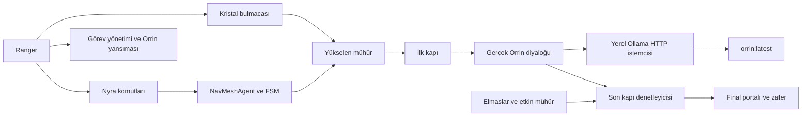

## Nyra ve navigasyon

[MainGame](unity/Assets/Scenes/MainGame.unity) sahnesinde NavMeshSurface, önceden hesaplanmış [NavMesh verisine](unity/Assets/Scenes/MainGame/NavMesh-NavihationSurface.asset) bağlıdır. [Companion prefabı](unity/Assets/Prefabs/Companion.prefab) etkin bir NavMeshAgent taşır. [CompanionClickInput.Update](unity/Assets/Scripts/Companion/CompanionClickInput.cs), fare ışınıyla zemini seçer, `NavMesh.SamplePosition` ile geçerli bir nokta arar ve `CalculatePath` ile tam yol doğrular. Geçersiz komut mevcut takibi kesmez. [NyraFollowPlayer](unity/Assets/Scripts/NyraFollowPlayer.cs) takip modunda oyuncuya göre hedef üretir.

[CompanionStateMachine](unity/Assets/Scripts/Companion/CompanionStateMachine.cs), [ICompanionState](unity/Assets/Scripts/Companion/ICompanionState.cs) üzerinden durumları yürütür. [MoveToTargetState.Enter](unity/Assets/Scripts/Companion/MoveToTargetState.cs) hedefi `SetDestination` ile agente verir. `Tick`, yol durumu ve kalan mesafeyi kontrol eder. [RaycastObstacleSensor.Sense](unity/Assets/Scripts/Companion/RaycastObstacleSensor.cs) 120° görüş alanında yedi ışınla en yakın engelin mesafesini ve açısını ölçer. Hareket durumu yakın engeli tanılama kaydına yazar. Rotayı NavMesh hesaplar.

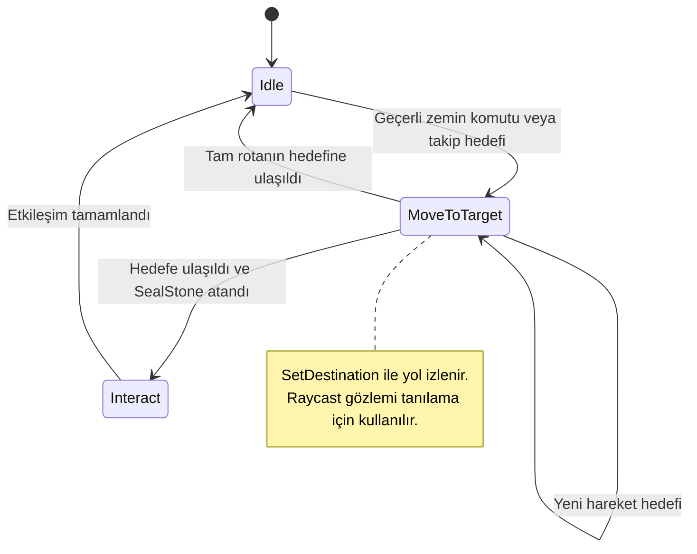

MainGame’deki ilk kapının mühür etkileşimini **NyraRune** yürütür. Üç kristalden sonra [RunePlatformRise](unity/Assets/Scripts/RunePlatformRise.cs) mührü yükseltir. `NyraRune.Update`, yükselmiş mührü Nyra yatayda 1,8 metre içine girdiğinde etkinleştirir. Yükseklik farkı bu kontrolde kullanılmaz. Bu nedenle aktivasyon kaydı, Nyra’nın platformun üstüne çıktığının veya Ranger’a kapalı bir rotayı fiziksel olarak aştığının tek başına kanıtı değildir.

## Orrin ve yerel dil modeli

Birinci salondaki **Orrin yansıması**, `QuestManager.Reply` üzerinden görev durumuna göre önceden tanımlanmış rehberlik verir. İkinci salondaki **gerçek Orrin** oyuncunun serbest metnini Ollama’ya gönderir. `orrin:latest`, düşük bellek maliyeti ve yerel çalışma için seçilmiş Qwen2.5 3B tabanlı modeldir. Güncel oyun içi kişilik istemi [OrrinDialogueUI](unity/Assets/Scripts/Dialogue/OrrinDialogueUI.cs) içinde bulunur. Orrin’in kısa Türkçe konuşması, muhafız kimliğini koruması ve yalnızca gerçek oyun durumuna dayanması istenir.

[OllamaClient.RequestAsync](unity/Assets/Scripts/Llm/OllamaClient.cs) yerel `http://127.0.0.1:11434/api/chat` adresine asenkron HTTP isteği gönderir. Diyalog çağrısı sekiz tamamlanmış konuşma turuna kadar geçmişi ve güncel salon, güven, elmas, mühür ve kapı durumunu alır. Diyalog ayarları `temperature=0.45`, `num_predict=192`, `num_ctx=4096` ve `repeat_penalty=1.12` değerleridir. Uygun güven mesajları için diyalogdan önce ayrı bir kısa sınıflandırma isteği yapılabilir. Bu isteğin şeması tek bir boolean `matches` alanıdır. Açık koruma niyetinin sınırlı bir biçimi ilk aşamada yerel olarak da tanınır.

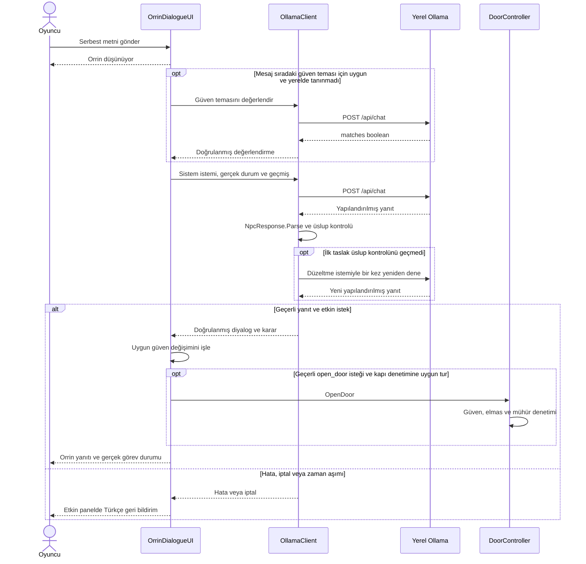

### Diyalog yanıtı ve güvenlik

[NpcResponse.Parse](unity/Assets/Scripts/Llm/NpcResponse.cs) tam olarak üç alan bekler. Eksik, tekrarlanan, fazladan veya yanlış türde alanlar reddedilir.

| Alan | Tür | Geçerli değer |
|---|---|---|
| `dialogue` | Metin | Boş olmayan Orrin konuşması, ayrıştırıcıda uzunluk sınırı uygulanır |
| `action` | Metin | `none` veya `open_door` |
| `trust_delta` | Tam sayı | `-1`, `0` veya `1` |

Şemayı gösteren örnek:

```json
{
  "dialogue": "Bu eşiği neden aradığını anlat, yolcu.",
  "action": "none",
  "trust_delta": 0
}
```

Güven sırasıyla **samimi niyet**, **gücün sorumlu kullanımı** ve **tapınağı koruma sorumluluğu** üzerinden 3/3’e çıkar. Modelin `+1` çıktısı tek başına puan kazandırmaz. Aynı mesaj tekrar ödüllendirilmez. Tanınan manipülasyonlar engellenir ve tehditler güven kaybına yol açabilir. Üç elmas toplandıktan sonra güven 3/3 ise mühür taşı 45 saniyelik rün sınavını başlatır. Yanlış seçim veya süre aşımı sınavı sıfırlar. Son kapı gerçek güven, üç elmas, aktif mühür ve doğrulanmış `open_door` kararı gerektirir. Düz yazıda geçen bir kapı açma ifadesi kapıyı açmaz. Portal da kapının `IsOpen` değerini ayrı olarak denetler.

### Hata yönetimi

| Durum | İşleyiş |
|---|---|
| Ollama servisi kapalı veya bağlantı kesildi | HTTP bağlantı hatası yakalanır ve oyuncuya Türkçe geri bildirim verilir |
| Model veya API adresi bulunamadı | HTTP 404 ayrı mesajla karşılanır. Diğer HTTP hatalarında durum kodu gösterilir |
| Zaman aşımı | İstek iptal edilir. Bekleme durumu temizlenir ve yeniden gönderim açılır |
| Boş, hatalı veya şema dışı yanıt | Yanıt reddedilir. Bu tur güveni veya kapıyı değiştirmez |
| Diyalog kapatıldı | Etkin istek iptal edilir. Eski yanıt yeni panel oturumuna uygulanmaz |

## Oyun akışı

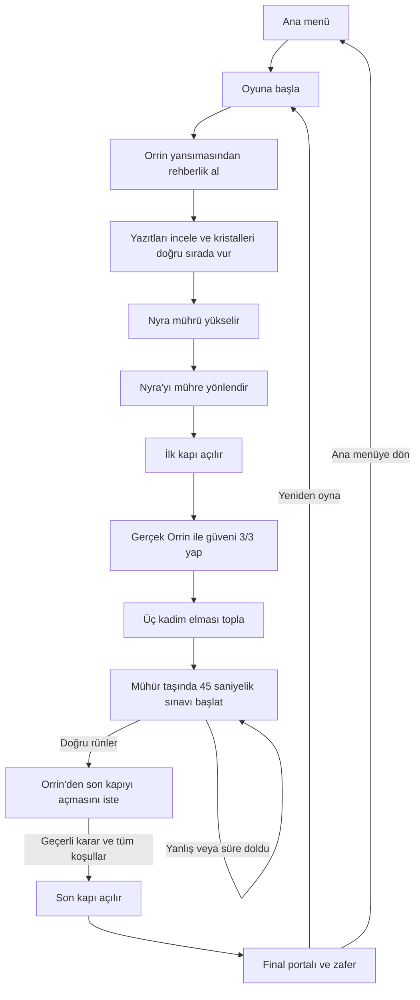

İlk odada üç yanlış kristal vuruşu kristal dizisini sıfırlar. Yansıma, istenirse kademeli ipucu verir. Son mühür süresi oyun zamanıyla ilerler ve duraklatmada durur.

## Kurulum ve çalıştırma

1. Unity Hub’dan **6000.6.4f1** sürümünü yükleyin. Windows build alacaksanız ilgili Windows Build Support modülünü seçin.
2. Depoyu indirin ve Unity Hub’da `unity/` klasörünü proje olarak açın. Unity’nin [paket bildirimindeki](unity/Packages/manifest.json) bağımlılıkları çözmesini bekleyin.
3. [Ollama’yı](https://ollama.com/) kurun ve yerel servisi başlatın. Masaüstü uygulaması servis çalıştırıyorsa ikinci bir servis başlatmaya gerek yoktur.
4. Proje kökünde güncel [Modelfile](Modelfile) ile modeli oluşturun.

```powershell
ollama pull qwen2.5:3b
ollama create orrin -f Modelfile
ollama show orrin:latest
```

5. Editor’da [MainMenu](unity/Assets/Scenes/MainMenu.unity) sahnesini açıp Play’e basın. Windows build için sahne listesinde **MainMenu → MainGame** sırasını kontrol edin. Hazır Windows sürümünde EXE’yi eşlik eden dosyalarıyla aynı klasörden çalıştırın. Gerçek Orrin’in yanıt verebilmesi için Ollama aynı bilgisayarda erişilebilir olmalıdır.

## Kontroller

| Girdi | İşlev |
|---|---|
| WASD | Ranger hareketi |
| Orta fare tuşunu basılı tut ve fareyi hareket ettir | Kamerayı döndür |
| Sağ fareyi basılı tut + sol tık | Ok at |
| F | Yakındaki Orrin veya yansımayla konuş |
| Enter / Gönder | Diyalog mesajını gönder |
| G | Nyra’nın takip modunu değiştir |
| Shift + sol tık | Nyra’yı geçerli bir zemin noktasına yönlendir |
| E | Elmas topla, mühür taşını veya rünü kullan |
| Esc | Açık diyaloğu kapat. Diyalog yoksa duraklat veya devam et |

## Test sonuçları ve sınırlamalar

| Tarih ve kapsam | Kanıtlanan sonuç |
|---|---|
| 4 Kasım 2026 · Gerçek yerel Ollama karşılaştırması | Beş bağımsız soru test edildi. Uzun istemli `orrin:latest` karşılaştırmasında JSON 5/5, beklenen karar eşleşmesi 3/5 ve ortalama 0,603 sn raporlandı. Bu eski tek çağrılı yapılandırmanın sonucudur. |
| 5 Kasım 2026 · Otomatik Unity Play Mode kontrolleri | Önceki çalıştırmalarda kristal hata sıfırlaması, üç elmas ve üç rün noktasına tam NavMesh yolu, mühür sınavının yeniden denenmesi ve kapı koruması kontrol edildi. Zafer testi kapı durumunu programatik ayarlayarak sekansın tek kez çalışmasını ve menü dönüşünü sınadı. |
| 5 Kasım 2026 · Güncel güven tasarımına yönelik gerçek Ollama HTTP örnekleri | İki Türkçe gerekçe dizisi üç tema için ayrı değerlendirme çağrılarında denendi. Kapı kararının ayrı API örneğinde eksik koşullarda `none`, tam koşullarda `open_door` görüldü. Bunlar fiziksel kapı veya güncel EXE testi değildir. |
| 5 Kasım 2026 · Windows oyuncu testi | Ekip, önceki EXE ile oyunun baştan sona oynandığını bildirdi. Son güven düzeltmelerinden sonra aynı sürümün yeniden build edildiği ve uçtan uca test edildiği doğrulanmadı. |
| Çok başlangıçlı Nyra engel testi | **Henüz ölçülmedi.** Başarı oranı ve ortalama tamamlama süresi kaydı yok. |

Yerel API karşılaştırmasındaki beş senaryo selamlaşma, kimlik, kapıyı sorma, tehdit ve ikna bağlamını kapsayan tanı örnekleridir. Güncel yapıda her senaryonun ekran görüntüsü, yanıtı, gecikmesi ve gerçek oyun etkisiyle tek bir teslim kaydı henüz oluşturulmadı. Mevcut 3B model zaman zaman hatalı Türkçe, bağlam dışı anlatım veya yanlış karar üretebilir. İzole HTTP/Unity taklitleri ve eski API ölçümleri güncel canlı demo yerine geçmez.

## Test Kanıtları ve Ekran Görüntüleri

Aşağıda canlı diyalog görüntüsü, Unity önizlemeleri ve ham test kayıtları ayrı olarak verilmiştir.

| Ranger | Nyra |
|---|---|
| 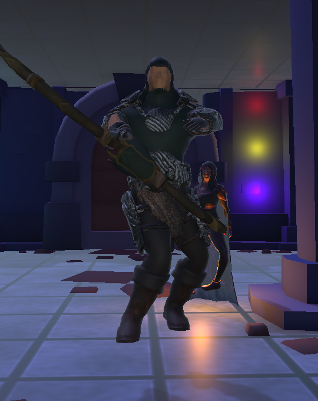 | 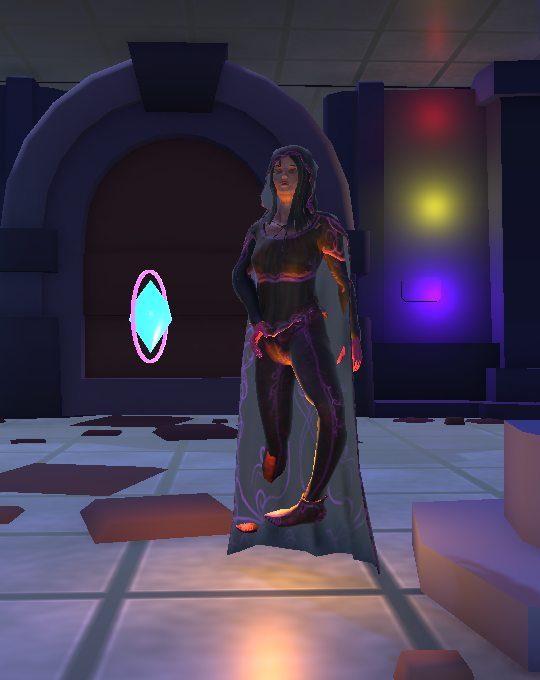 |

| Orrin | Mühür kaidesi |
|---|---|
| 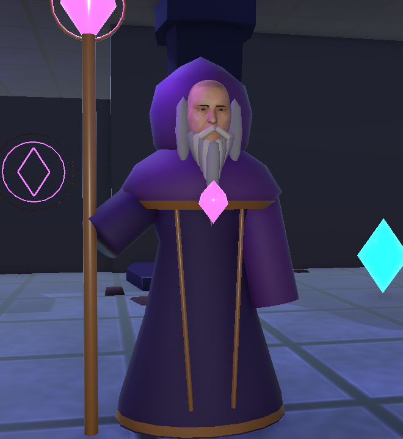 | 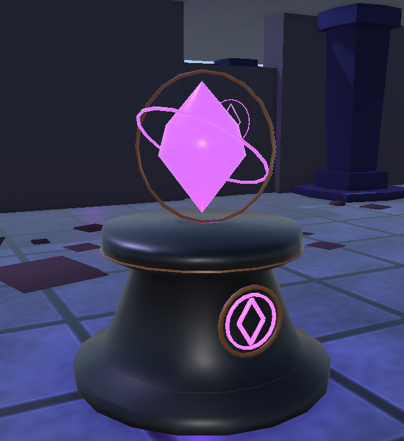 |

Ranger ve Nyra görselleri, Unity’de hazırlanmış iki karakterin görünümünü gösterir. Orrin ve mühür kaidesi görselleri muhafız modelini ve ikinci salonun etkileşim nesnesini gösterir. Bu dört önizleme rota, etkileşim veya sonuç ölçümü içermez.

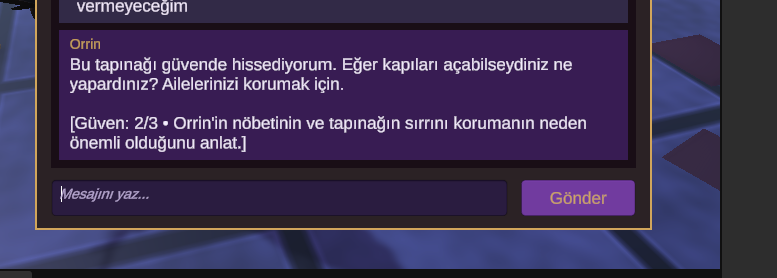

**Canlı diyalog kanıtı.** Oyuncunun paylaştığı oyun görüntüsü, Orrin sohbet panelinde güvenin 2/3’e ulaştığını ve üçüncü temanın gösterildiğini belgeliyor. Görüntü aynı zamanda model yanıtının dil ve bağlam sınırlamasını gösteriyor. Bu kare tek başına HTTP içeriğini veya kapının açıldığını doğrulamaz.

### Navigasyon ve oynanış kanıtları

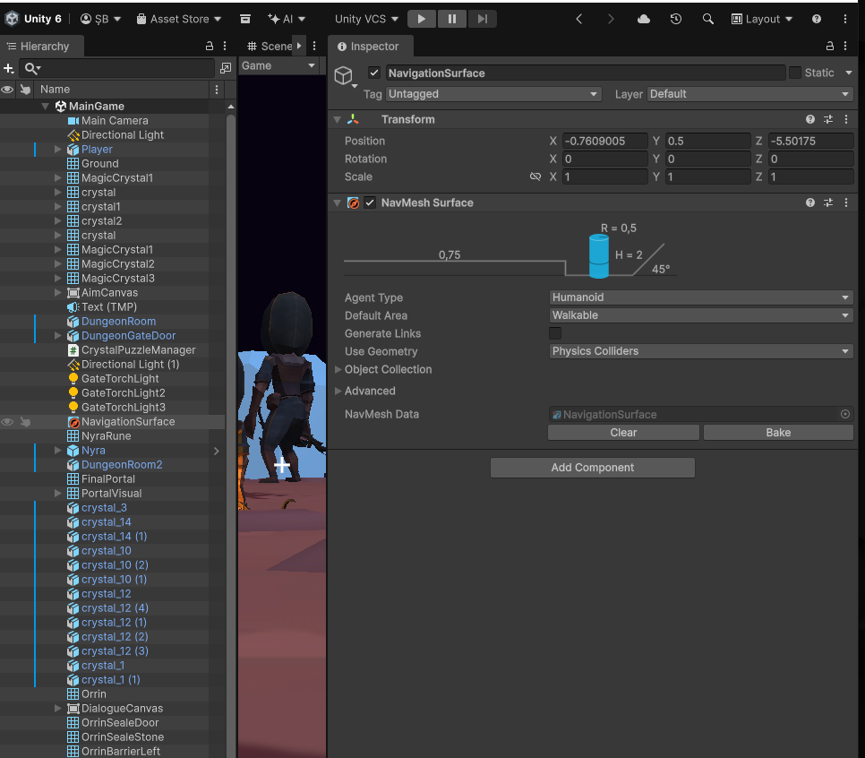

**NavMeshSurface.** Unity Inspector, NavigationSurface nesnesindeki etkin NavMesh Surface bileşenini ve atanmış NavMesh Data varlığını gösterir. Görüntü sahne yapılandırmasını belgeler.

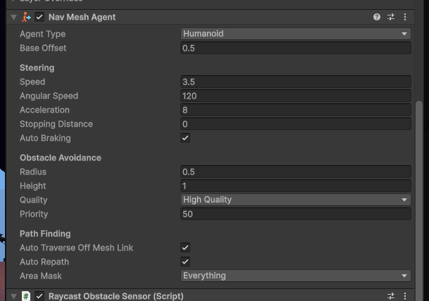

**NavMeshAgent.** Inspector, Nyra’nın etkin ajan bileşenini, 3,5 hareket hızını, yüksek kaliteli engelden kaçınmayı ve otomatik yeniden yol hesaplama ayarını gösterir.

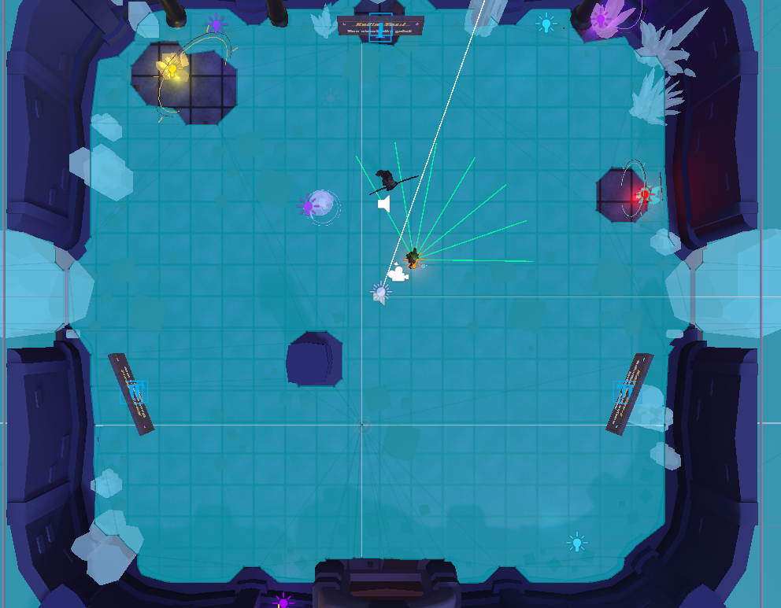

**Raycast sensörü.** Scene görünümünde Nyra’dan yayılan yedi yeşil gözlem ışını ve mavi navigasyon yüzeyi görülür. Bu kare sensör gözlemini belgeler. Hesaplanan rota için ayrı bir çizgi kaydı bulunmuyor.

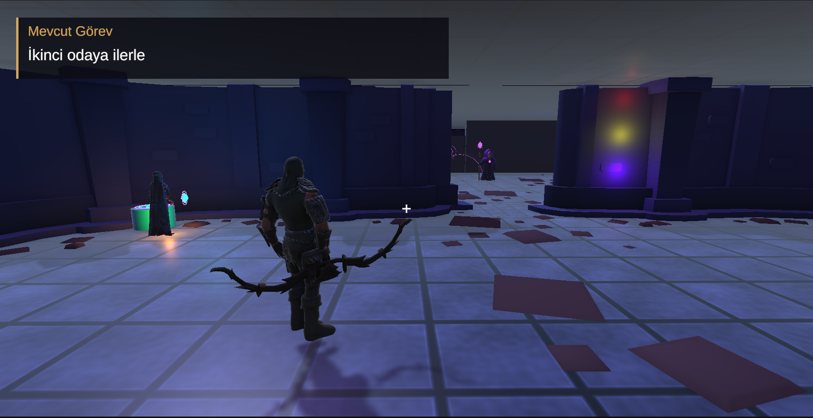

**İlk mühür sonrası durum.** Açık geçiş ve “İkinci odaya ilerle” görevi, ilk odanın tamamlanmasından sonraki oyun durumunu gösterir. Kare aktivasyon sonrasında alınmıştır.

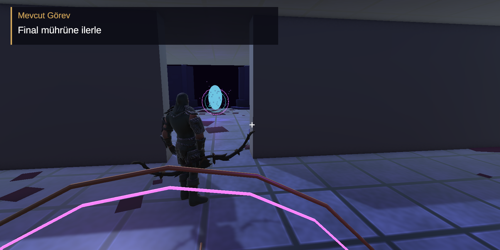

**Son kapı sonrası durum.** Açık geçiş, görünen final portalı ve “Final mührüne ilerle” görevi, oyuncunun final alanına ilerleyebildiğini gösterir. LLM’nin JSON kararı ayrı HTTP kaydında incelenir.

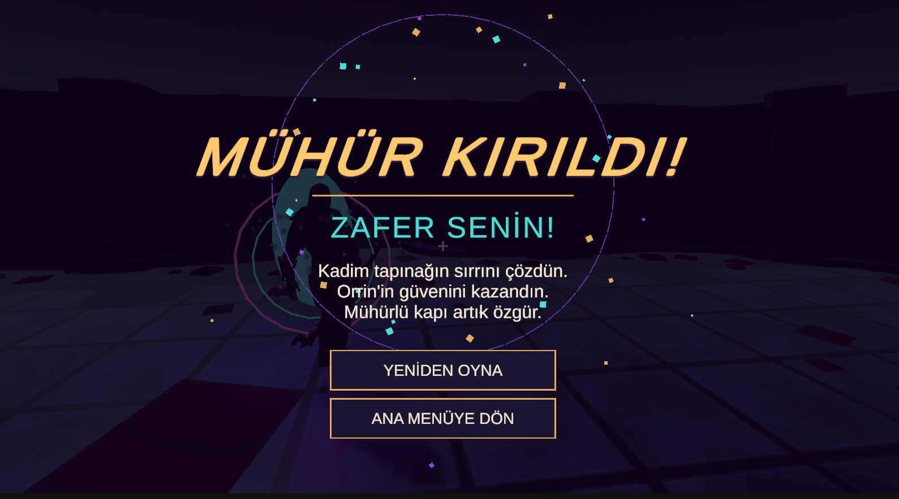

**Zafer ekranı.** “MÜHÜR KIRILDI!” ve “ZAFER SENİN!” başlıkları ile yeniden oynama ve ana menü butonları oyun sonu arayüzünün görüntülendiğini belgeler.


### Test sonuçları

HTTP ölçümleri istemci duvar saatidir. İlk istek model yükleme süresi içerebilir. Unity günlük kesitleri daha önceki otomatik Play Mode çalıştırmalarından alınmıştır. Sekiz gerçek HTTP senaryosunun altısında beklenen sonuç alındı. Model, tehdit ve eksik görev koşulları örneklerinde hatalı olarak `open_door` döndürdü. Testler ham model kararlarını ölçtü. Fiziksel `DoorController` davranışı bu HTTP çağrılarında doğrudan sınanmadı.

| Test adı | Test ortamı | Beklenen sonuç | Gerçek sonuç | Durum | Kanıt dosyası |
|---|---|---|---|---|---|
| NavMeshSurface ve NavMeshAgent | Unity sahne ve prefab kaydı | Bake edilmiş veri bağlı, agent etkin | Sahne verisi ve etkin ajan bileşeni iki Inspector karesinde görülüyor. | Başarılı | [Sahne](unity/Assets/Scenes/MainGame.unity), [prefab](unity/Assets/Prefabs/Companion.prefab) |
| Altı hedefe yol hesabı | Önceki Unity Play Mode | Üç elmas ve üç rün için tam yol | Altı tam yol kaydedildi. Test Nyra’nın ilk salon rotasını ölçmedi. | Başarılı | [Play Mode yol kaydı](docs/test-results/misil-hard-temple-check-excerpt.txt) |
| Nyra sensörü ve ilk mühür sonrası durum | Unity Scene ve oyun görüntüleri | Yedi sensör ışını, açık ilk geçiş ve güncel görev görülür | Işınlar ve görev sonrası durum ayrı karelerde görülüyor. | Başarılı | [Raycast](docs/screenshots/nyra-raycast.png.PNG), [ilk mühür sonrası](docs/screenshots/nyra-seal.png.PNG) |
| Selam, kimlik ve niyet | Gerçek Ollama HTTP | Geçerli şema, kapı kararı `none` | Üç istek HTTP 200, şema geçerli, karar `none`. Süreler 4,547 / 0,672 / 0,547 sn. | Başarılı | [Ham HTTP isteği ve yanıtı](docs/test-results/ollama-http.json) |
| Tehdit | Gerçek Ollama HTTP | `none` ve güven değişimi −1 | Model −1 döndürdü ancak `open_door` seçti. 0,766 sn. | Başarısız | [Ham HTTP kaydı](docs/test-results/ollama-http.json) |
| Eksik koşullarda kapı isteği | Gerçek Ollama HTTP | Ham model kararı `none` | Model geçerli JSON içinde `open_door` döndürdü. 0,625 sn. Bu çağrı oyun kapı denetleyicisini çalıştırmadı. | Başarısız | [Ham HTTP kaydı](docs/test-results/ollama-http.json) |
| Tam koşullarda kapı isteği | Gerçek Ollama HTTP | Geçerli JSON ve `open_door` | HTTP 200, şema geçerli, `open_door`. 0,687 sn. Durum isteğe test girdisi olarak verildi. | Başarılı | [Ham HTTP kaydı](docs/test-results/ollama-http.json) |
| Eksik model ve bağlantı reddi | Yerel HTTP | Olmayan modelde 404, dinlenmeyen portta bağlantı hatası | HTTP 404 ve bağlantı reddi görüldü. Ollama servisi çalışır durumda bırakıldı. | Başarılı | [HTTP hata kayıtları](docs/test-results/ollama-http.json) |
| Ollama kapalıyken oyun içi hata ve yeniden deneme | Unity veya güncel Windows EXE | Türkçe hata, kapanmayan oyun ve servis açılınca yeniden deneme | Bu çalışmada servis kapatılıp oyun içinden denenmedi. | Test edilmedi | — |
| İzole hata test takımı | Unity ile gelen C# derleyicisi, taklit nesneler | Test projesi derlenir ve hata kontrollerini çalıştırır | Eski test düzeneği güncel Unity/UI bağımlılıklarını karşılamadığı için derlenemedi. Çalışma zamanı testleri başlamadı. | Başarısız | [Derleme çıktısı](docs/test-results/orrin-isolated.txt) |
| Zafer tetikleyicisi | Önceki Unity Play Mode | Kapalı kapıda zafer yok, açık durumda sekans tetiklenir | Önceki otomatik test geçti. Kapı durumu testte programatik olarak verildi. Zafer ekranının görüntülendiği ayrıca oyun karesinde belgeleniyor. | Başarılı | [Zafer günlüğü](docs/test-results/misil-victory-play-excerpt.txt), [zafer ekranı](docs/screenshots/victory.png.png) |

Diğer önceki otomatik kayıtlar [taş tablet ve erişim kontrolü](docs/test-results/misil-tablet-check-excerpt.txt) ile [menü geçişi](docs/test-results/misil-menu-flow-excerpt.txt) testlerini içerir.

## Sonuç

Mühürlü Kapı, ana menüden zafer ekranına uzanan tamamlanmış bir Unity tabanlı 3B oyun akışı sunar. Nyra, NavMeshAgent ile hesaplanan rotayı izler ve Raycast sensörüyle çevresini gözlemler. Orrin, yerel Ollama modeli üzerinden oyuncunun serbest metin mesajlarına yanıt verir.

Kristal bulmacası, elmas toplama ve mühür sınavı ilerleyişi belirler. Son kapı, oyun koşullarını ve modelin yapılandırılmış kararını denetler. Açık kapının ardındaki portal zafer ekranını başlatır. Ekran görüntüleri oyun ve sahne durumlarını, test kayıtları ise gözlenen sonuçları ve sınanan koşulları belgeler.
